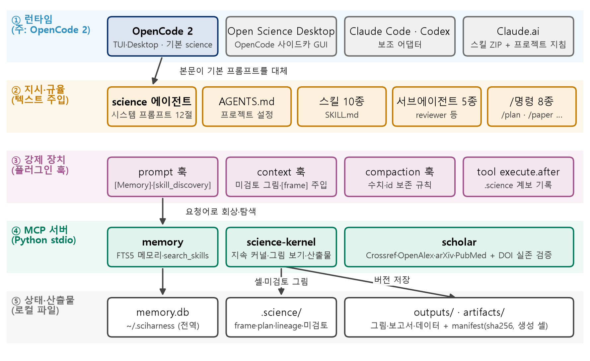

# open-science — OpenCode 를 Claude Science 급으로 동작시키는 하네스

> 지원: **OpenCode 2**(기본, `--target opencode`) · **OpenCode 1.x**(`--target opencode-v1`) · Claude Code · Codex · Claude.ai

OpenCode 2(주 대상)·Claude Code·Codex·Claude.ai 에 **지시문 + 스킬 + MCP 서버 + 플러그인 훅**을 주입해
Claude Science 와 같은 작업 규율로 동작하게 만드는 팩입니다.

- 지속 Python 커널 계산, 산출물 버전·해시·생성 셀 계보
- 출판 품질 그림(한국어 글꼴, CVD 안전 팔레트, 겹침 검사) + **저장 후 눈으로 확인(render-then-verify) 강제**
- 개념도/아키텍처 다이어그램 DSL
- 실존이 확인된 인용만 쓰는 문헌 도구(Crossref·OpenAlex·arXiv·PubMed, DOI 검증)
- 논문급 글쓰기 게이트 G0–G4, 읽기 전용 리뷰어 서브에이전트
- `[Memory]` 회상·`[skill_discovery]` 자동 주입, 압축 후 연속성(`.science/frame.md`)



설계 근거·비교 분석·검증 결과: [docs/proposal_ko.md](docs/proposal_ko.md) ([HTML](docs/html/proposal_ko.html)), 데이터 뷰어: [docs/interactive/harness_data_viewer.html](docs/interactive/harness_data_viewer.html)

## 빠른 시작 (Windows PowerShell)
```powershell
git clone https://github.com/eljja/open-science; cd open-science
conda create -n sciharness python=3.11 -y; conda activate sciharness
pip install -e python
python tools/install.py --doctor
python tools/install.py --target opencode --project D:\research\myproj      # 주 런타임
npm install -g @opencode/cli                                                # OpenCode 2
cd D:\research\myproj; . .\.opencode\sciharness.env.ps1; opencode
```
OpenCode 1.x: `python tools/install.py --target opencode-v1 --project D:\research\myproj` (`npm install -g opencode-ai@1`). V2 가 설치된 폴더에는 V1 설치를 건너뜁니다.

**오프라인(인터넷·npm 없음)**: 인터넷 PC 에서 `python tools\offline\build_bundle.py --opencode both --models --zip` 로 번들(OpenCode 바이너리 + Python wheel + V1 플러그인 의존성 + 모델 카탈로그)을 만들고, 대상 PC 에서 `install_offline.ps1 -Project <폴더> [-Target opencode-v1]` 를 실행합니다. 자세한 절차: [tools/offline/OFFLINE_README.md](tools/offline/OFFLINE_README.md). 일반 설치에서도 `install.py --offline` 로 scholar 비활성·자동 업데이트 끔·오프라인 규칙을 적용할 수 있습니다.

다른 런타임: `--target claude-code`, `--target codex`, `--target claude-ai --out dist`(스킬 ZIP + 프로젝트 지침), `--target all`.
설치기는 sha256 매니페스트로 재설치를 멱등하게 처리하고, 사용자가 고친 파일은 건너뜁니다(`--force` 시 `.science/backup/`에 백업 후 덮어쓰기). `--dry-run` 으로 미리보기.

## 구성
| 경로 | 내용 |
|---|---|
| `harness/prompts/science_system.md` | science 에이전트 시스템 프롬프트(12절, 런타임 공통 핵심 규율) |
| `harness/templates/AGENTS.project.md` | 프로젝트 설정 템플릿(언어, 보고서 형식, 저장 위치) |
| `harness/skills/` | 스킬 10종 (Agent Skills 표준 SKILL.md) |
| `harness/agents/` | 서브에이전트 5종 원본(설치기가 런타임별 형식으로 변환) |
| `harness/commands/` | 슬래시 명령 8종 |
| `harness/opencode/plugins/science-harness/index.ts` | OpenCode 2 플러그인(prompt/context/compaction/tool 훅) |
| `harness/opencode-v1/plugins/science-harness.ts` | OpenCode 1.x 플러그인(chat.message / experimental.chat.system.transform / experimental.session.compacting / tool.execute.after) |
| `python/sciharness/` | 공용 Python 패키지: `figures`, `schematic`, `report`(Confluence HTML), `viewer`, `memory`, `skills_index`, `lineage`, `hooks`, `mcp_servers/`(kernel·scholar·memory) |
| `tools/install.py` | 다중 런타임 설치기(`--offline` 지원) |
| `tools/offline/` | 오프라인 번들 빌더(`build_bundle.py`), 설치 스크립트(`install_offline.ps1`/`.sh`), 안내서 |
| `tests/` | `smoke_test.py`(MCP), `test_install.py`, `test_hooks.py`, 실기 검증 `test_opencode_real.py`, 모의 LLM 종단 간 `test_e2e_mock_llm.py` |
| `docs/` | 제안서, 그림, 비교 데이터, 데이터 뷰어 |

## 검증 상태 (v0.2, 2026-11-17)
| 테스트 | 결과 |
|---|---|
| `python tests/smoke_test.py --inproc --offline` | 14/14 (scholar 네트워크 4건은 미실행) |
| `python tests/test_install.py` | 59/59 (OpenCode 1.x 14건, 오프라인 14건 포함) |
| `python tests/test_hooks.py` | 9/9 |
| `tests/test_opencode_real.py` — 실제 OpenCode 1.19.5, 네트워크 차단 | 10/10 (default_agent·에이전트 6·명령 8·플러그인·스킬 10·MCP 연결) |
| `tests/test_e2e_mock_llm.py` — 실제 OpenCode 1.19.5 / 2.3.0, 모의 LLM, 네트워크 차단 | 9/9 · 9/9 |

종단 간 테스트에서 확인한 것: science 프롬프트가 OpenCode 기본 프롬프트를 대체함, 플러그인 훅이 매 모델 호출에 `[skill_discovery]` 를 주입함, AGENTS.md(오프라인 규칙) 포함, `science-kernel`·`memory` MCP 도구가 직접 노출됨, `python_exec` 결과가 모델로 돌아감, `.science/lineage.jsonl` 에 커널 셀과 플러그인 도구 기록이 남음. V2 서버 API 로는 `science-harness` 플러그인이 `active`, reviewer 에 `edit deny` 가 적용됨을 확인했습니다.

**아직 검증하지 않은 것**: 실제 LLM(도구 호출 품질)으로의 장시간 작업, 그림 검토 게이트·압축 훅의 실기 동작, scholar 실네트워크 테스트, Codex/Claude Code/Claude.ai 실기 실행. 자세한 내용은 제안서 7절.

## 문제 해결
- `SetFileSecurity ... 액세스 거부`(Jupyter 연결 파일): 일부 샌드박스/관리형 PC 에서 ACL 변경이 막힌 경우입니다. 테스트 목적에 한해 `JUPYTER_ALLOW_INSECURE_WRITES=1` 을 설정할 수 있으나 기본값으로 쓰지 마세요.
- OpenAlex 는 `OPENALEX_API_KEY` 가 있을 때만 사용합니다. 없으면 Crossref 를 씁니다.
- OpenCode V2 는 `AGENTS.md` 만 읽습니다(`CLAUDE.md` 폴백 없음).
- OpenCode 1.x 가 폐쇄망에서 명령마다 1분 넘게 멈춤: 시작 시 `@opencode-ai/plugin` npm 설치를 시도하기 때문입니다. 오프라인 번들의 `v1-deps` 를 쓰세요(OFFLINE_README 4절).
- OpenCode 2 `debug config`/`mcp list` 가 500: 백그라운드 서비스가 git 실행 파일 등에 접근하지 못하는 환경일 수 있습니다. `opencode serve` + `--server` 로 확인하거나 서버 로그(`~/.local/share/opencode/log`)를 보세요.

## 라이선스
저장소의 LICENSE 를 따릅니다. 비교·흡수한 외부 프로젝트의 아이디어는 자체 문장과 코드로 다시 구현했으며, 외부 코드를 복사하지 않았습니다.
