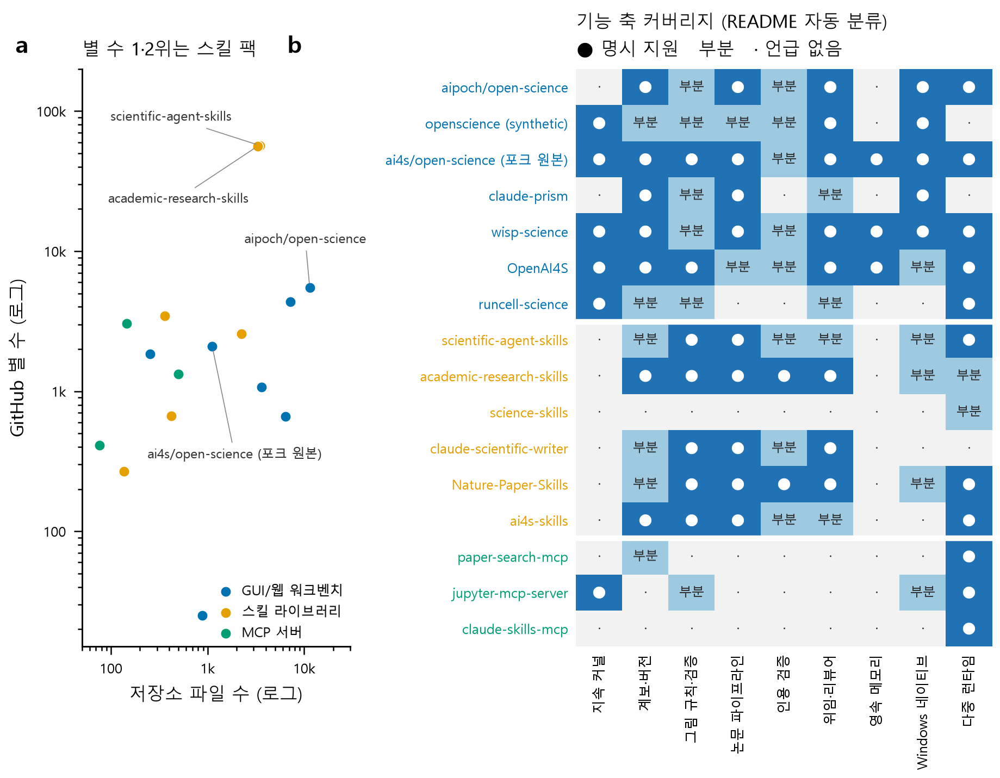
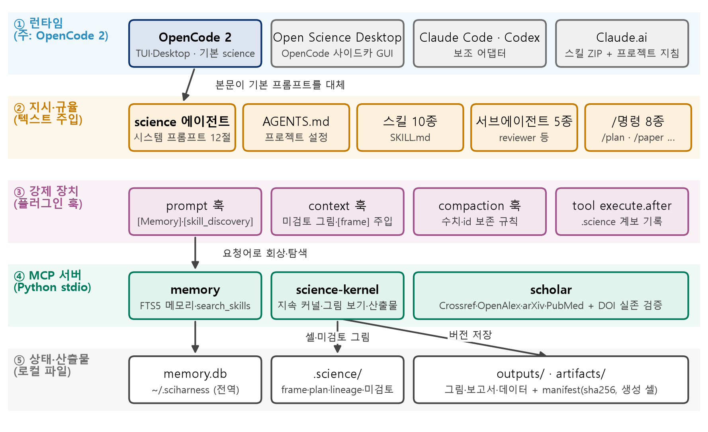
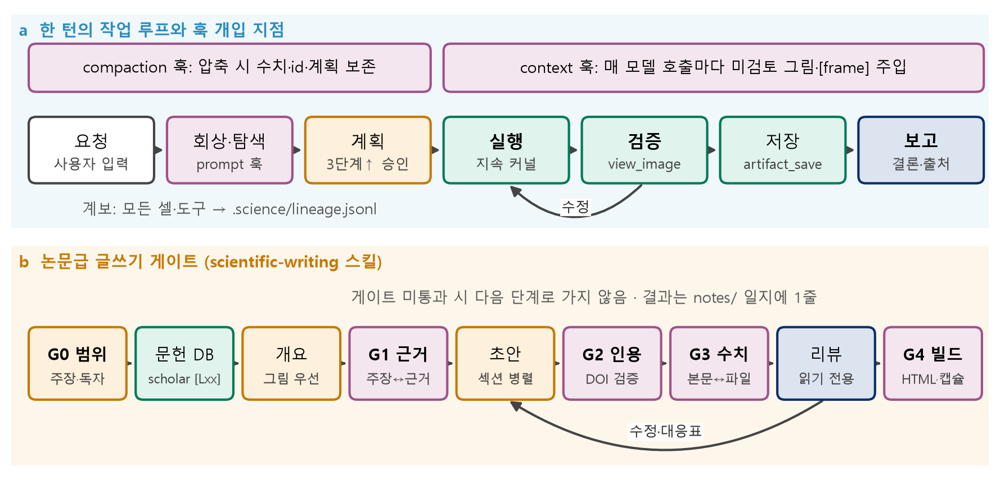
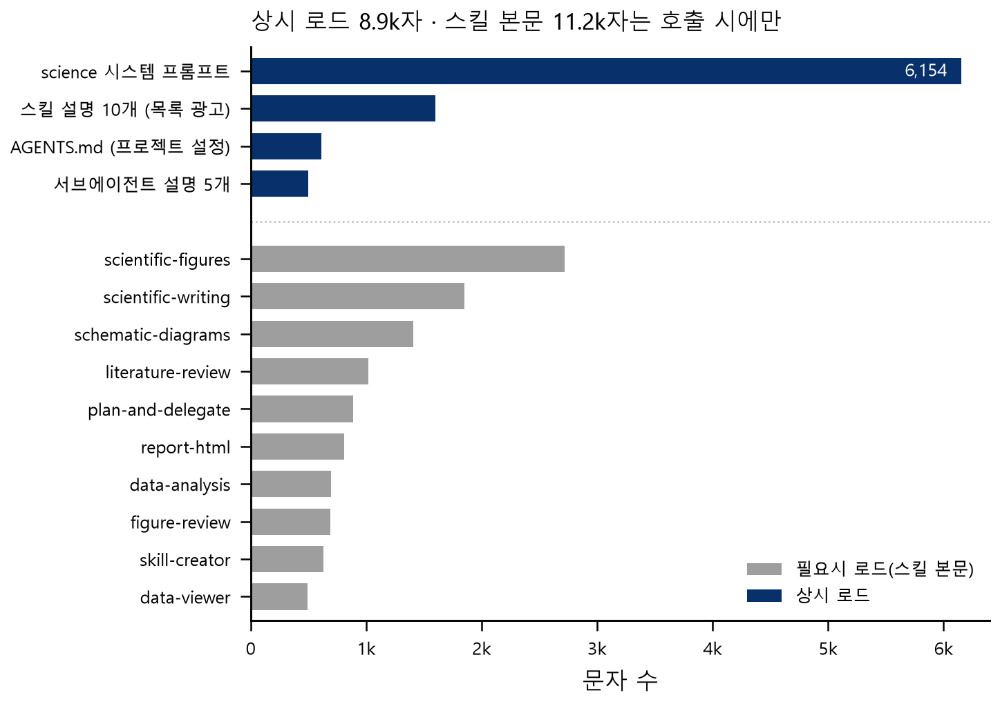

# OpenCode를 Claude Science급으로 동작시키는 하네스 설계와 구현 (open-science v0.1)

| 항목 | 내용 |
|---|---|
| 작성 | 2026-11-12 · v0.1 |
| 목적 | Claude.ai·Claude Code·Codex·OpenCode에서 Claude Science와 같은 동작(지속 커널 계산, 출판 품질 그림·개념도, 검증된 인용, 논문급 글)을 재현. **주 대상은 OpenCode 2** |
| 산출물 | 하네스 키트 `science-harness/`(→ GitHub `eljja/open-science`), 본 보고서, 그림 5종, 비교 데이터, 데이터 뷰어 |
| 결론 | GUI 앱을 새로 만들지 말고 **지시문·스킬·MCP·플러그인 훅을 주입하는 팩**으로 간다. OpenCode 2의 primary 에이전트 시스템 프롬프트 교체 + 플러그인 훅 + Python MCP 서버 3종으로 핵심 동작을 구현했고, 오프라인 범위 테스트 53/53을 통과했다. OpenCode 실기 실행은 아직 검증하지 못했다 |

## 요약
- **동작의 원천은 GUI가 아니라 규율이다.** Claude Science 의 차별점은 (1) 결과 충실성 규칙, (2) 지속 커널과 산출물 계보, (3) 그림을 저장한 뒤 눈으로 확인하는 render-then-verify, (4) 실존이 확인된 인용만 쓰는 문헌 규칙, (5) 메모리 회상·스킬 탐색 블록의 자동 주입, (6) 독립 트랙 위임과 deviations 감사다. 이 여섯 가지는 텍스트 지시 + 도구 + 훅으로 옮길 수 있다.
- **공개 대안 16종 비교**(그림 2): GUI 워크벤치 7종의 파일 수 중앙값은 3.6k로 스킬 팩(1.3k)의 약 3배다. 별 수 1·2위는 스킬 팩(56.7k, 56.4k)이고 GUI 최고는 5.5k다. 런타임과 무관하게 행동을 **강제**하는 장치(미검토 그림 차단, 회상 주입, 압축 보존 규칙)를 체계적으로 갖춘 저장소는 없었다.
- **OpenCode 2 구현**(그림 1): `.opencode/agents/science.md`의 본문이 제공자 기본 프롬프트를 대체한다. 플러그인의 `prompt`/`context`/`compaction`/`tool.execute.after` 훅이 Claude Science의 주입 블록을 재현한다. MCP 서버 `science-kernel`·`scholar`·`memory`가 계산·문헌·기억을 맡는다.
- **검증**: MCP 서버 스모크 14/14(오프라인 범위, scholar 네트워크 4건은 이번 실행에서 미실행), 설치기 31/31, 훅 8/8. OpenCode 실기 실행, 플러그인 TypeScript 실행, Codex·Claude Code 실기 실행은 **미검증**(7절).

## 1. Claude Science 동작의 분해와 이식 방법

| Claude Science 동작 | 메커니즘 | OpenCode 구현 | 상태 |
|---|---|---|---|
| 결과를 도구로 만든다, 연구 노트 문체 | 시스템 프롬프트 | science 에이전트 본문 1·2절 | 작성 |
| 보고하는 수치는 실행 출력·파일에서만 | 시스템 프롬프트 + 계보 | 3절 + `artifact_lineage` | 작성·테스트 |
| 지속 Python 커널 | 커널 도구 | `science-kernel.python_exec` (Jupyter, 세션별) | 테스트 |
| 저장한 그림을 눈으로 확인 | `view_image` + 강제 | `view_image`(크롭) + 미검토 목록 + context 훅 경고 | 테스트(훅 로직) |
| 산출물 버전·해시·생성 셀 | artifact 저장소 | `artifact_save`(불변 사본, sha256, producing_cells) | 테스트 |
| `[Memory]` 회상 주입 | 메모리 DB + 주입 | `memory` MCP + prompt 훅 | 테스트(훅 로직) |
| `[skill_discovery]` 주입, `search_skills` | 스킬 색인 | BM25 어휘 검색 + prompt 훅 | 테스트 |
| 실존 인용만 | 문헌 API | `scholar.doi_resolve`/`verify_citations` | 오프라인 오류 처리만 테스트 |
| 계획 → 승인 | 계획 파일 | `plan-and-delegate` 스킬, `/plan` | 작성 |
| 독립 트랙 위임 + deviations | 서브에이전트 | 5종 + 출력 계약 | 작성 |
| 압축 후에도 이어가기 | frame 메모장 + 압축 규칙 | `.science/frame.md` + compaction 훅 | 작성 |
| 안전(외부 텍스트=데이터, 비밀값, 파괴적 작업) | 프롬프트 + 권한 | 10절 + permissions(ask) | 작성 |

## 2. 기존 GitHub 시도와의 비교



| 저장소 | 범주 | 파일 | 별 | 라이선스 | 커널 | 계보 | 그림 | 논문 | 인용 | 위임 | 메모리 | Win | 다중런타임 | 합 |
|---|---|---|---|---|---|---|---|---|---|---|---|---|---|---|
| aipoch/open-science | GUI/웹 워크벤치 | 11,417 | 5,510 | Apache-2.0 | · | ● | △ | ● | △ | ● | · | ● | ● | 12 |
| synthetic-sciences/openscience | GUI/웹 워크벤치 | 7,247 | 4,366 | Apache-2.0 | ● | △ | △ | △ | △ | ● | · | ● | · | 10 |
| ai4s-research/open-science | GUI/웹 워크벤치 | 1,119 | 2,087 | NOASSERTION | ● | ● | ● | ● | △ | ● | ● | ● | ● | 17 |
| delibae/claude-prism | GUI/웹 워크벤치 | 254 | 1,848 | MIT | · | ● | △ | ● | · | △ | · | ● | · | 8 |
| xuzhougeng/wisp-science | GUI/웹 워크벤치 | 3,608 | 1,069 | AGPL-3.0 | ● | ● | △ | ● | △ | ● | ● | ● | ● | 16 |
| PKU-YuanGroup/OpenAI4S | GUI/웹 워크벤치 | 6,379 | 662 | MIT | ● | ● | ● | △ | △ | ● | ● | △ | ● | 15 |
| runcell-ai/runcell-science | GUI/웹 워크벤치 | 886 | 25 | Apache-2.0 | ● | △ | △ | · | · | △ | · | · | ● | 7 |
| K-Dense-AI/scientific-agent-skills | 스킬 라이브러리 | 3,497 | 56,730 | MIT | · | △ | ● | ● | △ | △ | · | △ | ● | 10 |
| Imbad0202/academic-research-skills | 스킬 라이브러리 | 3,326 | 56,356 | NOASSERTION | · | ● | ● | ● | ● | ● | · | △ | △ | 12 |
| google-deepmind/science-skills | 스킬 라이브러리 | 362 | 3,445 | Apache-2.0 | · | · | · | · | · | · | · | · | △ | 1 |
| K-Dense-AI/claude-scientific-writer | 스킬 라이브러리 | 2,229 | 2,567 | MIT | · | △ | ● | ● | △ | ● | · | · | · | 8 |
| Boom5426/Nature-Paper-Skills | 스킬 라이브러리 | 420 | 667 | MIT | · | △ | ● | ● | ● | ● | · | △ | ● | 12 |
| ai4s-research/ai4s-skills | 스킬 라이브러리 | 137 | 268 | MIT | · | ● | ● | ● | △ | △ | · | · | ● | 10 |
| openags/paper-search-mcp | MCP 서버 | 146 | 3,048 | MIT | · | △ | · | · | · | · | · | · | ● | 3 |
| datalayer/jupyter-mcp-server | MCP 서버 | 502 | 1,323 | BSD-3-Clause | ● | · | △ | · | · | · | · | △ | ● | 6 |
| K-Dense-AI/claude-skills-mcp | MCP 서버 | 76 | 411 | Apache-2.0 | · | · | · | · | · | · | · | · | ● | 2 |

(●=명시, △=부분, ·=언급 없음. 합 = 9축 × 0–2점. 2026-11-11 GitHub API 메타데이터 + README 자동 분류.)

**읽는 법.** 범주별 커버리지 합의 중앙값은 GUI 12, 스킬 팩 10, MCP 서버 3이다. 가장 넓은 것은 사용자 포크의 원본 `ai4s-research/open-science`(17)로, OpenCode 2 사이드카를 내장한 Tauri 앱이다. 우리 팩은 OpenCode 프로젝트 설정(`.opencode/`)으로 설치되므로 이 앱 안에서도 그대로 쓸 수 있다(단, 앱이 프로젝트 폴더의 `.opencode/`를 읽는지는 실기 확인 필요).

### 2.1 흡수한 요소

| 출처 | 아이디어 | 우리 쪽 구현 |
|---|---|---|
| ai4s-research/open-science | 리뷰어: 읽기 전용, 근거 없으면 침묵, 최대 8개, "옳다"고 단정 금지 | `reviewer` 서브에이전트 |
| ai4s-research/open-science | `present_artifact`: 도구 성공 없이는 "표시했다" 금지 | 시스템 프롬프트 3절 |
| ai4s-research/ai4s-skills | 수치 진본성 라벨 measured/simulated/illustrative | 시스템 프롬프트, `artifact_save(data_status)` |
| Imbad0202/academic-research-skills | 단계별 무결성 게이트 | `scientific-writing` G0–G4 |
| Boom5426/Nature-Paper-Skills | 섹션별 작성 계약, 방어적 문체·AI 문체 제거 | `scientific-writing` |
| Boom5426/Nature-Paper-Skills, PKU-YuanGroup/OpenAI4S | 설치기 해시 매니페스트, 백업, dry-run | `tools/install.py` |
| xuzhougeng/wisp-science | 증거 캡슐(원고 리비전 동결) | `capsule_freeze` |
| K-Dense-AI/claude-skills-mcp | 스킬 검색 도구 | `memory.search_skills` + prompt 훅 |
| synthetic-sciences/openscience | 흡수한 외부 스킬의 출처·라이선스 명시 | 외부 스킬 가져올 때 규칙(로드맵) |
| K-Dense-AI/claude-scientific-writer | 다차원 동료평가 체크리스트 | `reviewer` 확인 순서 6항목 |
| datalayer/jupyter-mcp-server | 커널 MCP 패턴 | 자체 경량 구현(노트북 파일 없이 세션 커널) |

## 3. 배포 형태 결정: Windows GUI 앱 vs 지시문 주입

| 기준 | 자체 GUI 앱 | 주입형 팩(채택) |
|---|---|---|
| 동작 품질의 원천 | UI 와 무관 | 지시·스킬·도구·훅 = 품질의 원천 |
| 유지비 | 큼(포크의 데스크톱 앱만 777개 파일, 진행 기록 622KB) | 작음(Python 패키지 + Markdown) |
| 런타임 이식성 | 한 앱에 묶임 | OpenCode / Claude Code / Codex / Claude.ai |
| Windows | 설치기·서명·업데이트 직접 관리 | OpenCode 가 담당, 팩은 Python |
| GUI 가 필요할 때 | — | OpenCode Desktop 또는 Open Science Desktop 재사용 |

**권고.** 1단계로 팩을 완성하고 실기로 검증한다. GUI 가 꼭 필요하면 새로 만들지 말고 기존 GUI 를 재사용한다. 그래도 부족한 것은 산출물·계보를 보는 얇은 로컬 뷰어(HTML) 정도로 한정한다.

## 4. 아키텍처



### 4.1 OpenCode 2 연결 지점 (공식 문서 기준, 2026-11 확인)
- **에이전트**: `.opencode/agents/<id>.md`, frontmatter `description`, `mode: primary|subagent`, `permissions: [{action, resource, effect}]`. 비어 있지 않은 본문은 그 에이전트의 제공자 기본 프롬프트를 대체하고, 프로젝트 지시문·스킬 안내는 그 뒤에 덧붙는다. `default_agent: "science"`.
- **MCP**: `mcp.servers.<이름> = {type: "local", command: [...], environment: {...}}`. 이미지 반환이 모델에 그대로 가도록 `science-kernel`은 `codemode: false`.
- **스킬**: `.opencode/skills/<id>/SKILL.md` (`.claude/skills`, `.agents/skills`도 탐색).
- **명령**: `.opencode/commands/*.md`, 본문 = 프롬프트 템플릿, `$ARGUMENTS`.
- **플러그인**: `.opencode/plugins/` 자동 로드, V2 `export default { id, setup(ctx) }`. `ctx.session.hook("prompt"|"context"|"compaction")`, `ctx.tool.hook("execute.after")`.
- **지시문**: V2 는 `AGENTS.md` 만 인식(CLAUDE.md 폴백 없음).
- V1 필드(`agent`, `prompt`, `tools`, `permission`, `maxSteps`)는 폐기. 플러그인 V1 API 는 V2 에서 실행되지 않으므로 같은 파일에 V1 `server()` 폴백을 함께 두었다(미검증).

### 4.2 Claude Science 주입 블록 ↔ OpenCode 훅

| 블록 | 생성 | 주입 시점 |
|---|---|---|
| `[Memory]` | `sciharness.hooks` → 메모리 검색(한국어 2-gram + 영문 단어, 희소 토큰 가중) | prompt 훅에서 계산 → context 훅에서 system 에 추가 |
| `[skill_discovery]` | SKILL.md frontmatter BM25 | 같음 |
| `[figure_review_pending]` | `python_exec` 가 `outputs/**/figures/*.png` 생성 시 자동 등록, `view_image` 가 해제 | 매 모델 호출(context 훅) |
| `[frame]` | `.science/frame.md` 끝 1,500자 | 매 모델 호출 |
| 압축 보존 규칙 | 고정 문구 | compaction 훅 |
| 계보 | 모든 도구 실행 | tool.execute.after → `.science/lineage.jsonl` |



## 5. 구성요소

### 5.1 MCP 서버 (Python, `sciharness` 패키지, mcp SDK 1.x·2.x 호환)

| 서버 | 도구 | 비고 |
|---|---|---|
| science-kernel | `python_exec`, `kernel_list`, `kernel_restart`, `view_image`, `artifact_save`, `artifact_list`, `artifact_lineage`, `capsule_freeze` | Jupyter 커널(세션별 상태 유지), 출력 6,000자 초과 시 파일로 분리, 인라인 그림 미리보기 반환, 셀 코드 `.science/cells/` 보관 |
| scholar | `crossref_search`, `openalex_search`, `arxiv_search`, `pubmed_search`, `doi_resolve`, `verify_citations` | OpenAlex 는 `OPENALEX_API_KEY` 없으면 건너뜀. 네트워크 실패 시 "검증되지 않음" 오류 반환 |
| memory | `memory_search`, `memory_read`, `memory_write`, `memory_replace`, `memory_remove`, `search_skills` | SQLite, entity(profile / project:<이름>), evidence 태그, 민감정보 패턴 거부 |

### 5.2 스킬·서브에이전트·명령
- 스킬 10종: scientific-figures, schematic-diagrams, figure-review, scientific-writing(템플릿 3종), literature-review, data-analysis, report-html, data-viewer, plan-and-delegate, skill-creator.
- 서브에이전트 5종: reviewer(읽기 전용), figure-critic(읽기 전용), literature-scout, data-analyst, section-writer. 모두 `## 결과` + `## deviations` 출력 계약. 서브에이전트의 추가 위임은 금지.
- 명령 8종: `/plan`, `/figure-check`, `/review`, `/lit-review`, `/report`, `/paper`, `/remember`, `/frame`.

### 5.3 그림·개념도
- `sciharness.figures`: `apply_figure_style()`(한국어 글꼴 자동, 3단 글자 크기, CVD 안전 팔레트, 주인공·비교·경보 색), `save_figure()`(PNG+SVG, 텍스트 겹침 검사, 패널 크롭 좌표, 그림 뒤 데이터 CSV, 사이드카 JSON), `panel_letter()`.
- `sciharness.schematic.Diagram`: 계층·상자·화살표 DSL. 그림 1·3 이 이 모듈로 그려졌다.


### 5.4 컨텍스트 예산



## 6. 다른 런타임 어댑터 (`tools/install.py --target ...`)

| 런타임 | 상시 지시 | 스킬 | 서브에이전트 | MCP | 강제 장치 |
|---|---|---|---|---|---|
| OpenCode 2 (주) | `.opencode/agents/science.md` 본문 + `AGENTS.md`(설정) | `.opencode/skills/` | `.opencode/agents/*.md` | `opencode.jsonc` `mcp.servers` | `.opencode/plugins/science-harness` |
| Claude Code | `CLAUDE.md`(핵심+설정) | `.claude/skills/` | `.claude/agents/*.md` | `.mcp.json` | `.claude/settings.json` hooks → `python -m sciharness.hooks claude <Event>` (Stop 차단 포함) |
| Codex | `AGENTS.md`(핵심+설정) | `.agents/skills/` | `.codex/agents/*.toml` | `.codex/config.toml` | `.codex/hooks.json` + `[features] hooks=true` |
| Claude.ai | 프로젝트 지침(변환본) | 스킬 ZIP 업로드 | — | 원격 배포 시 사용자 지정 커넥터 | 없음(규율은 지침에 의존) |

OpenCode 와 Codex 를 한 폴더에 함께 설치하면 핵심 규율이 `AGENTS.md`에 들어가므로, 설치기가 science 에이전트 본문을 "AGENTS.md를 따르라"는 안내문으로 바꿔 중복을 막는다(테스트됨).

## 7. 검증 결과와 미검증 항목

| 테스트 | 결과 | 범위 |
|---|---|---|
| `tests/smoke_test.py --inproc --offline` | 14/14 | 커널 10(상태 유지, 그림 저장+미리보기, view_image, 버전 2회, 계보, 실패 정직 보고, traceback, 캡슐) + 메모리 4(한국어 검색, 민감정보 거부, 스킬 검색) |
| `tests/test_install.py` | 31/31 | 4개 런타임 생성 파일 JSON/TOML/YAML 파싱, 권한, 멱등 재설치, 사용자 수정 보호, 공존 중복 제거 |
| `tests/test_hooks.py` | 8/8 | 회상·탐색 주입, 미검토 그림 Stop 차단 → view_image 후 해제, 무한루프 방지, SessionStart, 계보 |

**미검증(다음 단계에서 반드시 확인).**
1. OpenCode 2 실기 실행: 이 샌드박스에 Node 가 없고 네트워크도 끊겨 설치하지 못했다. 에이전트·MCP·명령 파일은 공식 문서 스키마에 맞췄지만 실제 로딩은 확인하지 못했다.
2. 플러그인 `index.ts` 실행: 훅 이름과 등록 방식(`session.hook`, `tool.hook`)은 문서 그대로지만, 이벤트 객체의 필드명(`sessionID`, `system`, `prompt.text`)은 방어적으로 처리했을 뿐 실제 값은 확인하지 못했다. 같은 파일의 V1 `server()` 폴백도 실행 전이다.
3. scholar 네트워크 4건(실제 DOI 확인, 가짜 DOI 거부, Crossref 검색, OpenAlex 키 없음 처리): 이번 실행 중 샌드박스 외부 네트워크가 끊겨 실행하지 않았다.
4. stdio 전송: 이 샌드박스가 Windows 네임드 파이프 생성을 막아 메모리 내 전송으로 테스트했다. 사용자 PC 에서는 `python tests/smoke_test.py`(stdio)로 확인해야 한다.
5. Codex, Claude Code, Claude.ai 실기 실행.
6. 샌드박스 전용 설정: 커널 테스트에 `JUPYTER_ALLOW_INSECURE_WRITES=1`을 사용했다(사용자 승인, `--inproc` 모드에서만). 배포 기본값은 꺼져 있다.

## 8. 설치와 사용 (Windows PowerShell)
```powershell
git clone https://github.com/eljja/open-science; cd open-science
conda create -n sciharness python=3.11 -y; conda activate sciharness
pip install -e python                       # mcp, jupyter_client, ipykernel, matplotlib, pandas, httpx, markdown
python tools/install.py --doctor
python tools/install.py --target opencode --project D:
esearch\myproj
npm install -g @opencode/cli                 # OpenCode 2
cd D:
esearch\myproj; . .\.opencode\sciharness.env.ps1; opencode
```
첫 확인 순서: `/mcps`에서 서버 3종 connected → "y=sin(x) 그림을 그려 저장하고 검증해" → `outputs/figures/`, `.science/lineage.jsonl`, `artifacts/manifest.jsonl` 생성 여부와 `[figure_review_pending]` 경고가 view_image 후 사라지는지 확인.

## 9. 한계와 로드맵

| 단계 | 내용 | 완료 기준 |
|---|---|---|
| 1 (현재) | 팩 v0.1, 오프라인 테스트 | 53/53 ✓ |
| 2 | OpenCode 2 실기: 에이전트·MCP·플러그인 훅 필드 확인, 패리티 과제 10개(그림·문헌·논문·위임) 수행 | 과제별 체크리스트 통과 |
| 3 | 외부 스킬 팩(K-Dense, DeepMind science-skills) 선택적 가져오기(출처·라이선스 명시), Codex/Claude Code 실기 | 동일 과제 런타임 간 비교 |
| 4 | 산출물·계보 로컬 뷰어(HTML), 원격 scholar/memory 배포(Claude.ai 커넥터) | 선택 |

**한계.** 이 하네스는 Claude Science 의 **규율과 도구 표면**을 재현한다. 모델 자체의 능력(장문 추론, 시각 판단 품질)은 OpenCode 에 연결한 모델에 따라 달라진다. 훅 주입은 문맥을 추가할 뿐이고, 모델이 끝까지 따르도록 강제하는 장치는 미검토 그림 경고(OpenCode)와 Stop 차단(Claude Code/Codex)까지다.

## 부록 A. 참고 문서
- OpenCode V2 문서: https://opencode.ai/docs/agents/ , /plugins/ , /build/plugins/server , /mcp-servers/ , /skills/ , /commands/ , /instructions/ , /migrate-v1/
- Codex: https://developers.openai.com/codex/subagents , https://developers.openai.com/codex/config-reference
- Claude Code: https://code.claude.com/docs/en/hooks , /sub-agents , /skills , /plugins
- 비교 저장소 16종: 2절 표(모두 github.com/<저장소>)
